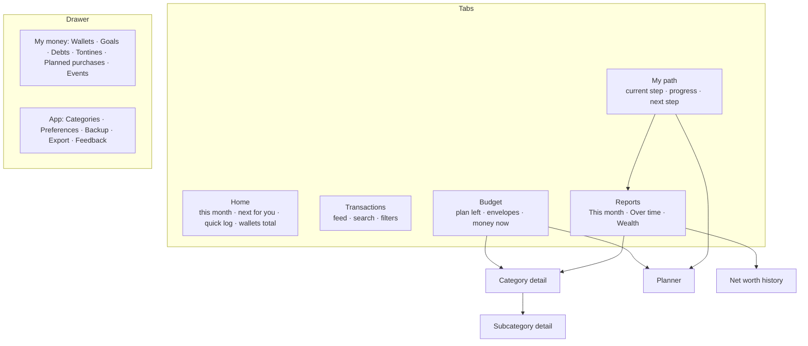

# 04 — Observation → optimisation strategy, onboarding, information architecture

Report sections 7, 8 and 9. These are **recommendations**; nothing is approved.

---

## 7. Observation-to-optimisation experience strategy

### 7.1 The four user stages already exist as the journey — reuse them

| User stage (brief) | User question | Journey step(s) that exist (VS-63) | Passes when (Verified, `journey.service`) |
|---|---|---|---|
| 1. Observation | What is happening to my money? | **Observe** | 3 complete months recorded |
| 2. Understanding | Why is my money behaving this way? | **See** | User marks "I've seen it" |
| 3. Control | What can I do to take control? | **Plan** | A fully logged month after the first three had a budget |
| 4. Optimisation | How do I improve over time? | **Optimize**, then **Grow** | A planned month beat the starting point's variable spend; then goals/reserve/net worth |

**Recommendation: do not invent a second stage model.** The journey is derived from data, never
a mode flag, can be skipped, and never re-locks — all decisions the user already made and all
consistent with R1 #3. What is missing is that *the rest of the app does not listen to it* (F-02).

### 7.2 Rules for a stage-aware app

1. **The step sets emphasis, never access.** Every screen and tool stays reachable. Content for a
   later step appears as a one-line preview — what it is, what unlocks it, *Show anyway* (VS-64
   model, already approved).
2. **Each screen has one "lead" per step** (table 7.3). The lead is what the user sees first;
   everything else follows in a fixed order.
3. **Facts and obligations are never staged.** Logged spending, wallet balances, and anything
   *due* (bills, planned purchases, debt instalments, tontine contributions) show at every step.
   An overdue tontine payment matters in week one.
4. **Every insight has a readiness threshold** (table 7.4). Below it, the screen says what is
   missing and how far away it is — never an empty chart, never a confident number.
5. **Skipping moves the emphasis, not the honesty.** A user who skips to Plan sees Plan's leads,
   but averages keep their *provisional* label until the evidence exists.
6. **Tone is neutral.** Overspending is stated as a fact with a next step, never in alarm colours
   at hero size (F-08, R9 hypothesis).

### 7.3 What each screen leads with, by step

| Screen | Observe | See | Plan | Optimize | Grow |
|---|---|---|---|---|---|
| **Home hero** | *Spent this month* + *days logged* (no limit shown) | Same + "your typical month: X" | **Left in your plan** + pace word | Same + "variable spending vs start" | Same |
| **Home next-for-you slot** | Due items › today's logging › Observe progress | Due › "Read your first months" | Due › plan next month | Due › biggest saving lever (VS-65) | Due › goal to fund |
| **Budget tab** | Preview: "Plan when your 3 months are in — *Plan anyway*" + envelopes if a plan exists | Same | Full budget (hero, envelopes) | Full + suggestions | Full + set-aside line |
| **Reports** | This month + logging coverage | This month + **Over time** opened | Month vs plan first | Month + Over time (vs start) | + Wealth group opened |
| **My path** | Observe detail with this month's days logged | See detail | Plan detail | Optimize detail | Grow detail |

### 7.4 Readiness thresholds (what an insight needs before it is shown as a number)

| Insight | Minimum evidence | Below it, show | Status today |
|---|---|---|---|
| Typical month, usual month, averages | 1 complete month; *provisional* until 3 | "N of 3 months · this month X of Y days logged" | Exists (labels Verified) |
| Starting point / Optimize comparison | 3 complete months (fixed once recorded) | Observe progress | Exists |
| Plan from averages | 1 complete month, provisional label | Copy last month / estimates | Exists |
| **Safe to spend / Free cash** | Every active wallet confirmed within ~30 days (proposed) and no unlinked spending | The figure with "balances not confirmed since …" and a *Check balances* link | **New (presentation only)** — data exists (`accounts.checks`) |
| Net worth | Wallets confirmed + debts recorded (baseline steps) | The figure labelled *partial* with what is missing | **New (presentation only)** — baseline steps exist |
| Savings rate | Income logged this month | "No income logged yet" | Exists |

### 7.5 Users with different readiness and complexity

- **Irregular earners:** the expected-income line ("planned on expected income · X of Y received")
  becomes part of the hero, not a caption, so the plan cannot silently exceed cash (R13 tension).
- **Users with debts or tontines:** their due items surface on Home from day one via the
  *Next for you* slot (rule 3), regardless of step.
- **Users who never finish Observe** (logging gaps): the path says plainly which month is short
  and by how many days, and offers to mark missed days as no-spend (D5).
- **Experienced users** skip ahead; leads follow the chosen step; nothing else changes.

```mermaid
flowchart LR
  O[Observe<br/>log 3 complete months] --> S[See<br/>read what a month costs]
  S --> P[Plan<br/>budget from your average]
  P --> Z[Optimize<br/>cut variable spending]
  Z --> G[Grow<br/>goals · reserve · net worth]
  O -. skip with warning .-> P
  subgraph Always available, never staged
    L[Logging · wallets · transfers · debts · tontines · due items]
  end
```

---

## 8. Proposed onboarding redesign

### 8.1 Principles

- Ask only what the **Observe** step needs; everything else is asked when its feature first
  matters (just-in-time). Avoid asking because the app can store it.
- Replace the four-card deck with **doing** (R4): the set-up *is* the first use.
- Every step skippable; every answer editable later in the place it lives.
- Missing data is visible as *not confirmed* / *your estimate*, never silently treated as zero.

### 8.2 First-run set-up (target: under 2 minutes, 3 screens, then the PIN)

VS-85 moved the PIN after these steps: a fresh install learns what the app does before it is asked
to lock it. An existing PIN still locks first.

| Step | User's goal | Question asked | Why it is needed | Mandatory? | Effect on first experience | If skipped | Change later |
|---|---|---|---|---|---|---|---|
| **S0 · What this app does** | Know what I'm signing up for | none — one screen: "Log every franc for a few months. The app shows what a month really costs you, then helps you plan it." + the five path steps as a strip | Sets the Observe expectation, replaces panels 1–4 | Viewed once (one tap) | My path makes sense when first seen | — | — |
| **S1 · Your wallets** | Start with true balances | "Which do you use, and roughly what is in each today?" (Cash, MTN MoMo, Orange Money pre-listed; add another) | Without it every wallet balance — and later *Free cash* and net worth — is wrong from day one (F-11) | Optional | Wallet totals on Home are real; the *checked today* badge shows | Wallets start at 0, marked *not confirmed*; Home shows *Check balances* in the next-for-you slot | Accounts → *Confirm balance* (exists, VS-42) |
| **S2 · Your logging moment** | Never forget a day | "When do you usually have a quiet minute in the evening?" (time picker, default 21:00) → then the OS notification permission | Coverage drives the whole Observe step (F-03) | Optional | Reminder scheduled; quiet on days with an entry (VS-57) | No reminder; ZeroDayGate still prompts on open | Settings → reminder |

**Recording the balance:** use a dated **balance check** (`accounts.checks`), not the undated
`opening_balance`, so later back-dated entries behave as the glossary describes.

**Architecture dependency.** `onboarding` may not import `accounts` today. Options: (a) approve an
`onboarding → accounts` edge for the wallet step; (b) S1 pushes the existing Accounts screen by path
(`/accounts?setup=1`) and returns, as `BaselineCard` does today. (b) needs no new edge;
(a) gives a smoother step. **Decision needed (D-arch-1).**

### 8.3 Deferred questions — asked when they first matter

| Question | Asked when | Where it lives today (Verified) | Why defer |
|---|---|---|---|
| Fixed vs variable categories | At **See**, beside the typical month split ("Looks right" one tap) | Categories, `CostTypeToggle`; baseline step `costTypes` | Only affects the fixed/variable split, which needs a complete month |
| Regular bills | At **See/Plan** — "Rent appeared 3 months running: make it a regular bill?" is *new detection logic* (Hypothesis, P2); P1 version: checklist item in the Plan step | `expenses/recurring`; baseline step `bills` | Committed money only matters once planning |
| Debts you owe / are owed | When the user first opens Debts, and in the Plan step checklist ("None" quick answer) | `debt`; baseline step `debts` | Not needed to observe; but due items surface whenever recorded |
| Income per month, regular or not, pay day, essentials | Plan step ("Before you plan" card) | `budget/estimates`; baseline step `estimates` | Feeds expected-income budgets and the reserve — Plan/Grow features |
| Goals, emergency reserve | Grow step (preview earlier) | `goals` | Pay-yourself-first needs a plan first |
| Tontines, events | When the user creates one | slices | Optional features |

**This splits the existing baseline checklist by step** instead of showing all five items on
My path from day one: *Confirm balances* belongs to set-up; *Fixed categories* to See; *Bills,
debts, estimates* to Plan. Data model unchanged (`baseline_facts` kinds stay as they are).

### 8.4 How Home and prompts evolve

| Moment | Home lead | Prompt in *Next for you* |
|---|---|---|
| Day 1 | Spent this month 0 · 0 of N days logged | "Log your first expense" or "Check balances" if S1 skipped |
| Week 2 | Spent so far · 11 of 14 days logged · "on track to count" | Missed day: "Nothing logged on Tuesday — mark as no-spend?" |
| First month short (mid-month start) | Same, plus "This month started on the 18th, so it won't count toward your 3 — your next month will." | — |
| Month 3 complete | "Your first 3 months are in" | "See what a month really costs you" → See |
| Plan step | **Left in your plan** + pace | Before you plan: bills · debts · income estimate |
| Optimize | Plan left + "variable spending vs start" | Biggest lever (VS-65) |
| Grow | Plan left + set-aside line | Fund a goal / reserve |

---

## 9. Revised information architecture

### 9.1 Should the dashboard stay a dashboard?

**Recommendation: no — make it a focused *Home* organised around the daily question.** NN/g
defines dashboards as at-a-glance views for quick action (R7); today's screen is six cards of
mixed purpose (F-20). The Home screen should answer *"Am I OK this month, and what do I need to
do now?"* and hand everything else to the tab that owns it. Tab label *Dashboard* → *Home* /
*Accueil* (minor, part of D2).

### 9.2 Structure



Tabs are **unchanged in number and order** (My path as a tab is the user's decision). The changes
are inside screens and in the drawer grouping (D7). No new screens of substance; two new
sheets (Free-cash breakdown, Next-for-you list).

### 9.3 Screen responsibilities

| Screen | User intent | Primary answer | Supporting context | Secondary (on demand) | Primary action | Exclusions (moved / removed) | Success criteria |
|---|---|---|---|---|---|---|---|
| **Home** | Am I OK; log now | Stage lead (7.3): spent + days logged → plan left + pace word | Days left; today's spend; one next-for-you item | All due items (sheet); wallet list (Accounts) | Log expense | *Net*, separate planned-due card, static journey goal, sparkline, per-wallet list | User states correctly what the big number means and where to log, in ≤5 s (test 13.2) |
| **Transactions** | Check and fix entries | This month's entries, grouped by day | Day spend; filters | Search results | Edit / add | Day *net* mixing income | Find a given expense in ≤15 s |
| **Add expense sheet** | Record fast | — | Remembered wallet, today's date | Event, note ("More details") | Save | Blocking modal (inline warning instead, if test supports) | Minimal entry ≤ 4 taps + typing |
| **Budget** | Can I afford it; where am I over | **Left in your plan** + pace word + per-day figure | Envelopes (2 lines each); unassigned/surplus action (one at a time) | Free-cash breakdown; insights; how the plan is built | Move money / edit plan | Duplicate *Budget left*; envelope footers unless at risk | Answers "can I buy X for 5,000?" correctly |
| **Category detail** | Why is this high | This month vs usual (labelled basis) | Where it went; why; repeats | Subcategory | Set next month | Unlabelled projected chips | Explains "+40%" basis |
| **Planner** | Share the month out | Unassigned → 0 | Usual spend per category; source of the total | — | Save plan | — | (unchanged; strong) |
| **Reports** | How did the month go | This month: spent vs plan vs income, and why | Categories (bar list); change vs last month | Over time (typical vs start; estimate vs actual); Wealth (net worth) | Open a category | Separate Unexpected card; donut (decision); stepper below unscoped cards | User names the month's 2 biggest drivers |
| **My path** | What now | Current step + measurable progress | What it unlocks | Locked previews; skip | The step's action | Full 5-item checklist on day 1 | User says what "complete month" means |
| **Wallets** | Do balances match reality | Total + each balance + last checked | Unlinked spending | History | Confirm balance | — | Balances confirmed within 30 days |

### 9.4 Trade-offs

- **Stage-aware leads vs predictability.** A hero that changes meaning between steps could
  confuse. Mitigation: the label always names the figure; the change happens once (Observe → Plan)
  and is announced on My path. Alternative (simpler): always show *Left in your plan* once a plan
  exists, *Spent this month* otherwise — this alone fixes most of F-02. **Recommended as the
  P0 version; the full table 7.3 is P1.**
- **Fewer cards on Home vs discoverability.** Removing the Planned-due card and wallet list moves
  them one tap away; the next-for-you slot keeps urgent items visible.
- **Reports grouping vs scrolling.** Collapsible groups add a disclosure level; kept to one (R2).
- **Not adding a "Money" hub tab.** Grouping the drawer is cheaper and avoids a sixth tab; revisit
  if goals/debts/tontines become daily-use features.
